# AICTE Copilot

An AI-assisted decision-support workspace for AICTE approval scrutiny. It validates an
institution's application and supporting documents against configurable regulatory
requirements, flags missing/expired/inconsistent evidence, simulates issuing-authority
verification, and prepares an evidence-linked scrutiny pack for authorised officials.

**The system never approves or rejects an application, never declares fraud, and never
replaces statutory scrutiny, inspection or a competent authority's decision.**

---

## 1. The problem

AICTE processes Extension of Approval (EoA) and other approval-related applications.
Manual scrutiny is time-consuming because:

- applications and supporting documents vary widely;
- documents may be missing, incomplete, expired or inconsistent;
- evidence may be duplicated or altered;
- confirming details with original issuing authorities is slow;
- infrastructure claims need documentary checks and sometimes physical inspection.

AICTE needs earlier, explainable preliminary validation that reduces repetitive checking
while keeping the final decision with authorised officials.

## 2. What this prototype does

A single conversational Copilot plus specialised workspaces, sharing one application
context:

| Capability | Implementation |
|---|---|
| Identify application category and checklist | 8 configurable category workflows (`apps/api/app/workflows/categories.py`) |
| Read/classify/extract documents | PyMuPDF text layer + RapidOCR (ONNX) for images/scans; keyword classification; regex extraction |
| Missing/incomplete/expired/inconsistent detection | Category checklist states + deterministic rule evaluators |
| Cross-document and institutional-record comparison | `cross_doc_match` and `reference_match` against simulated historical records |
| Potential duplication/anomaly flags | SHA-256 duplicate detection; preliminary anomaly flags requiring human review |
| Issuing-authority verification | Deterministic **simulated** adapter with six outcomes, clearly labelled |
| Infrastructure/EVC assistance | Evidence inventory, duplicate/missing evidence, declared-vs-floor-plan comparison, EVC recommendation and notes |
| Evidence-linked findings | Every finding carries rule, severity, evidence, values, lifecycle and human-review flag |
| Deficiency rectification | Clarification → correction document → revalidation → Resolved/Unresolved, with history retained |
| Reviewer workspace | Queue, observations, evidence requests, manual-verification flag, EVC recommendation |
| Dashboard/report/audit | Overview insights, report export, audit events |

The Copilot is grounded in the active application. It uses LangGraph tool calling with
`openai/gpt-oss-20b` (Groq free tier) when configured, with a deterministic fallback so
the demo always works.

## 3. Demo scenario

| Field | Value |
|---|---|
| Institution | Aarohan Institute of Technology, Pune (fictional) |
| Institution ID | `DEMO-AICTE-0001` |
| Application | `DEMO-EVENT-2026-001` |
| Category | Increase in Intake / Additional Course |
| Academic year | 2026–27 |
| Existing → proposed intake | 240 → 330 |

The dataset contains 16 synthetic documents plus 2 corrections. It deliberately includes:

- faculty count declared as **48**, listed as **45**, institutional record **42**;
- an **expired** fire NOC (2025-12-31) while the application claims 2027-03-31;
- **identical** laboratory/library images (duplicate evidence);
- a reference-number mismatch (`0142` vs `0143`);
- an affidavit naming the wrong city (Nagpur instead of Pune);
- a visually altered certificate scan.

Every document is marked
`SYNTHETIC DEMO DATA - NOT AN OFFICIAL AICTE DOCUMENT`.

## 4. Demo gallery — the working product

Every screenshot below was captured from the running prototype against the synthetic
Aarohan dataset. They show persisted results (validation findings, verification outcomes,
EVC and reviewer actions), not static mockups. Images are width-scaled only, so they keep
their original aspect ratio.

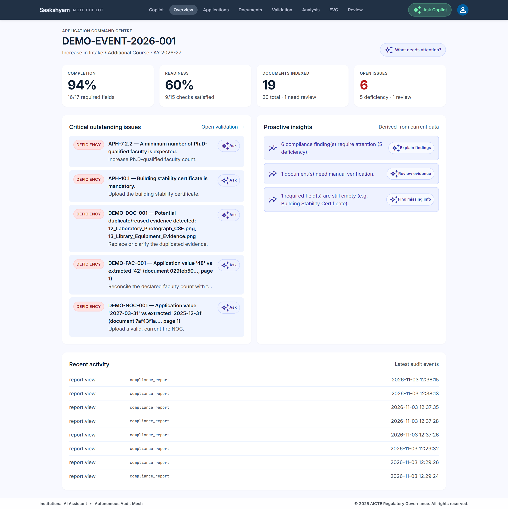

<p align="center"><sub><b>Overview.</b> 94% completion, 60% readiness, 20 documents (19 indexed) and 6 open issues (5 deficiencies + 1 manual review). Critical findings and recent audit events are visible in one place.</sub></p>

| | |
|---|---|
| 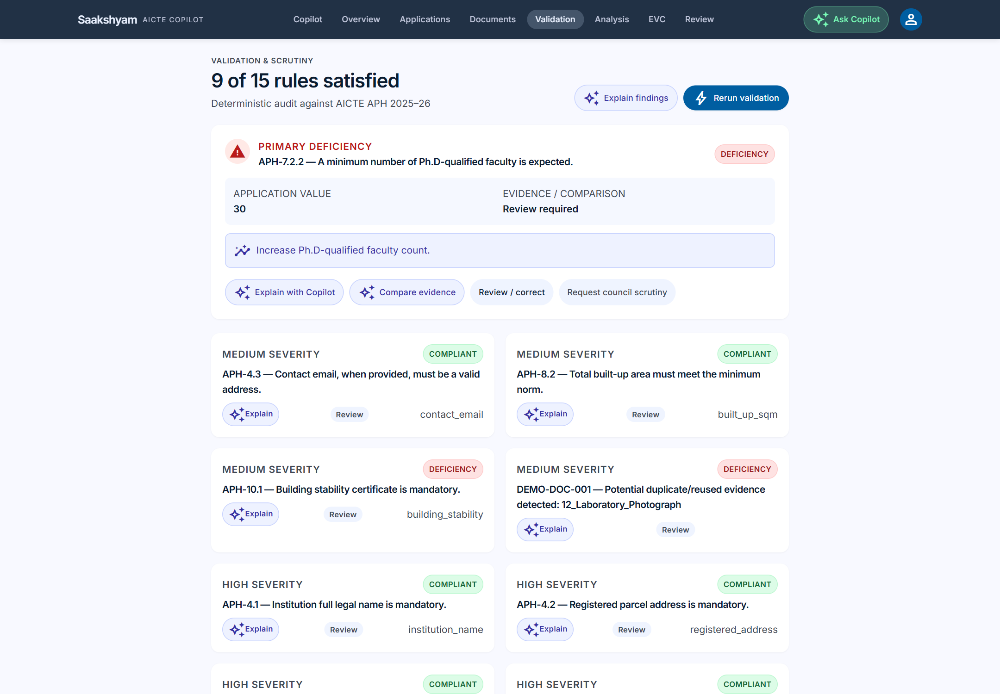<br><sub><b>Deterministic validation.</b> 9/15 rules satisfied. Each finding carries severity, status, field key and a remediation action; the primary deficiency is highlighted.</sub> | 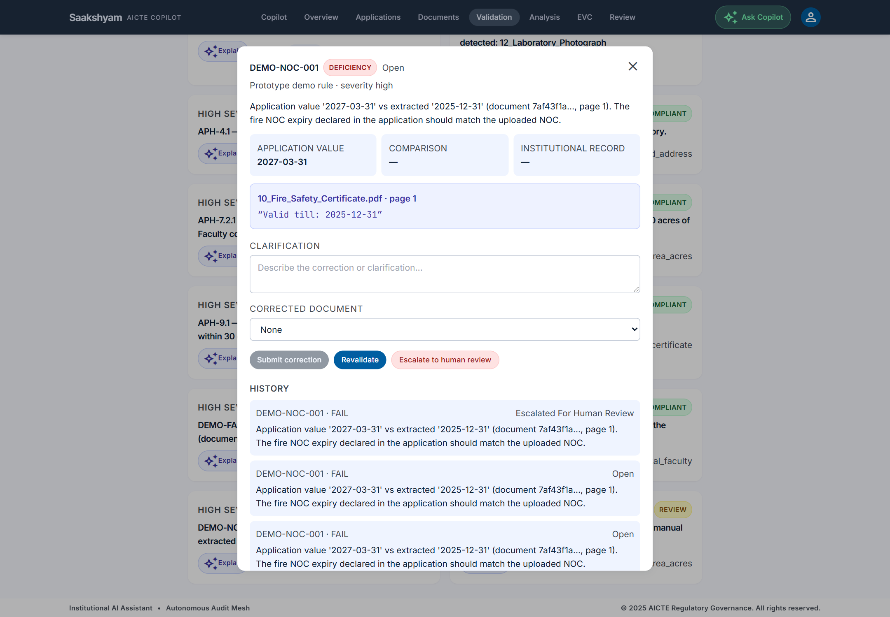<br><sub><b>Evidence-linked finding.</b> DEMO-NOC-001 compares the declared fire NOC expiry (2027-03-31) with the extracted date (2025-12-31), shows the source document, page and exact quote, and retains every prior run in history.</sub> |
| 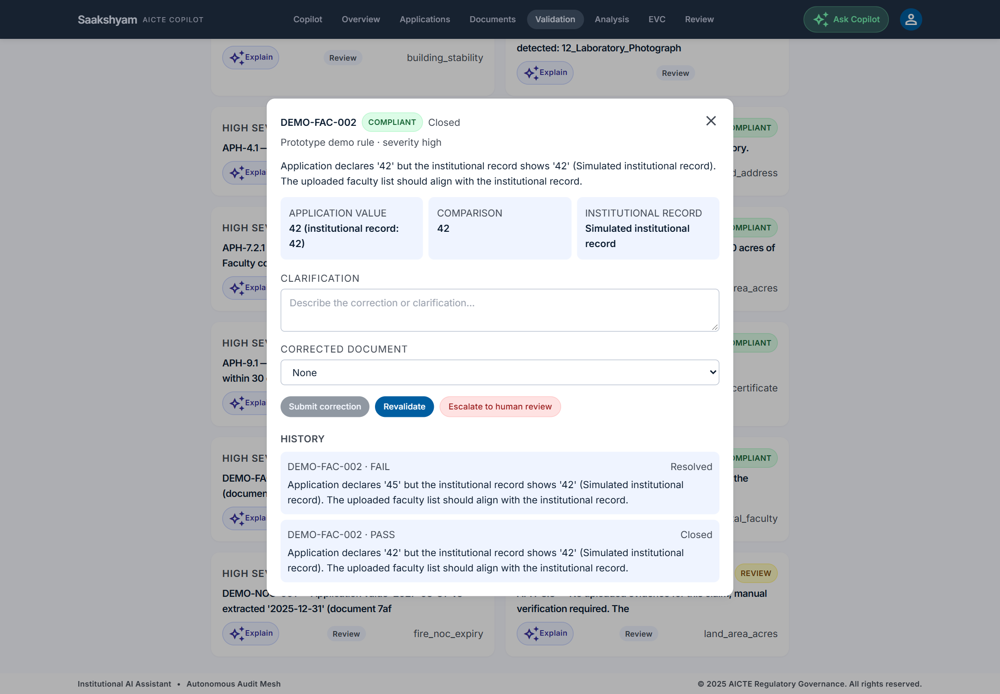<br><sub><b>Rectification lifecycle.</b> DEMO-FAC-002: FAIL → correction document → revalidation → PASS/Closed, with the original finding retained as <em>Resolved</em>.</sub> | 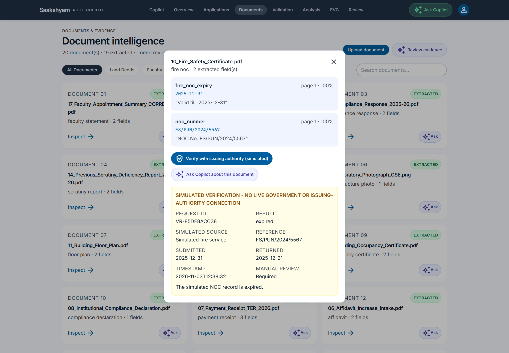<br><sub><b>Simulated verification.</b> The fire NOC check returns <em>expired</em> with request ID, simulated source, submitted/returned values and the mandatory <em>“no live government connection”</em> banner.</sub> |
| 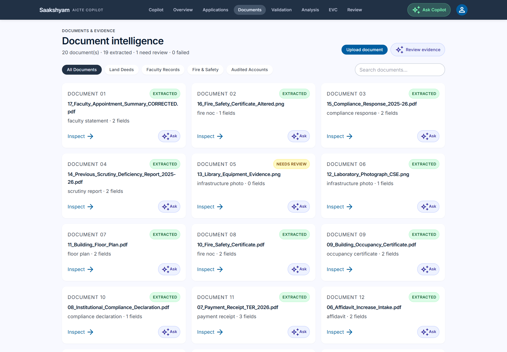<br><sub><b>Document intelligence.</b> 20 documents on file, 19 extracted, 1 needs review. The duplicate laboratory/library image is flagged and every document shows its class and extracted field count.</sub> | 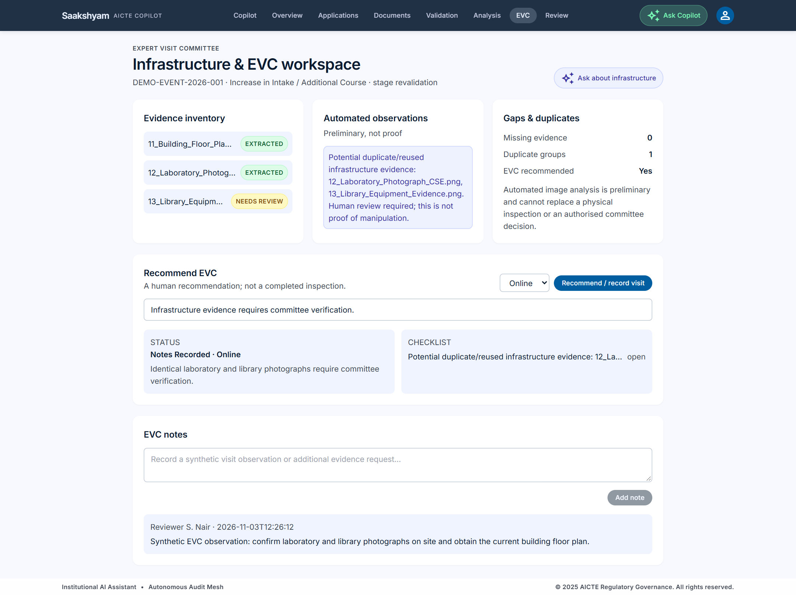<br><sub><b>Infrastructure / EVC.</b> The duplicate laboratory/library images are detected, EVC is recommended, a checklist is generated and a reviewer note is recorded. Missing evidence is computed, not assumed.</sub> |
| 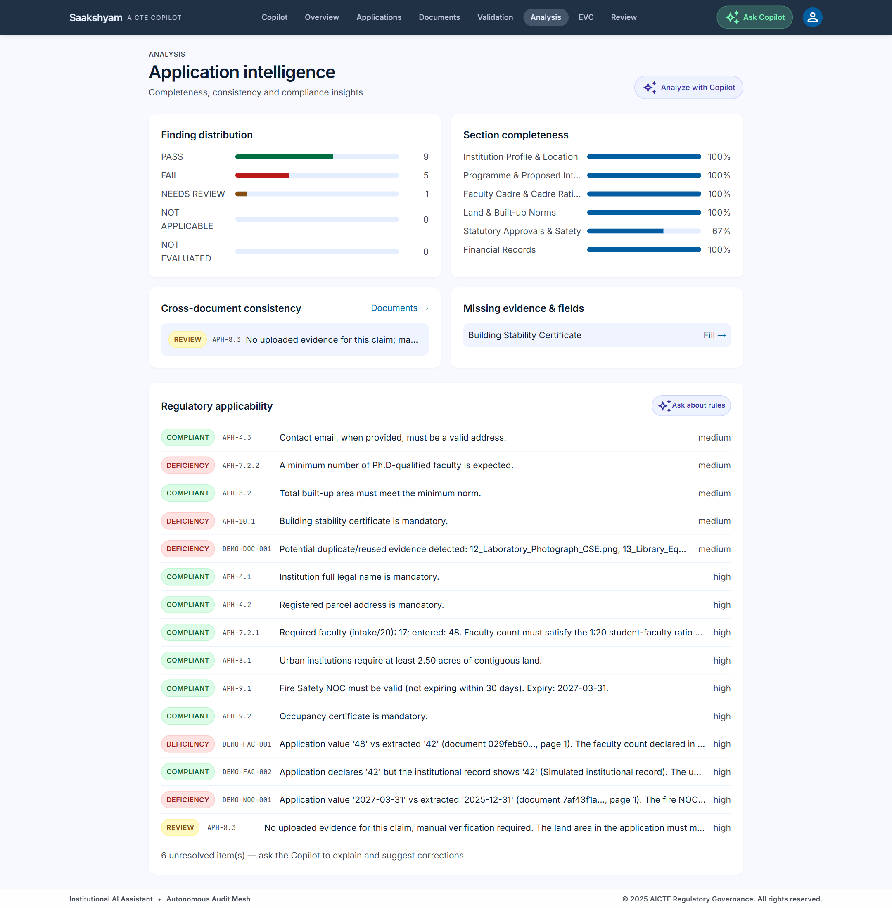<br><sub><b>Application intelligence.</b> PASS/FAIL distribution, per-section completeness, cross-document consistency, missing evidence and the full regulatory applicability list.</sub> | 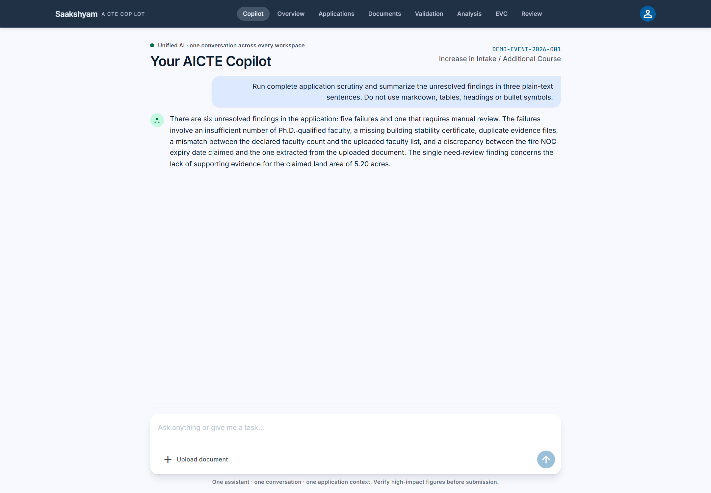<br><sub><b>Grounded Copilot.</b> The Copilot summarizes the six unresolved findings from persisted data. It runs on LangGraph with a free Groq model and falls back deterministically when no LLM is configured.</sub> |
| 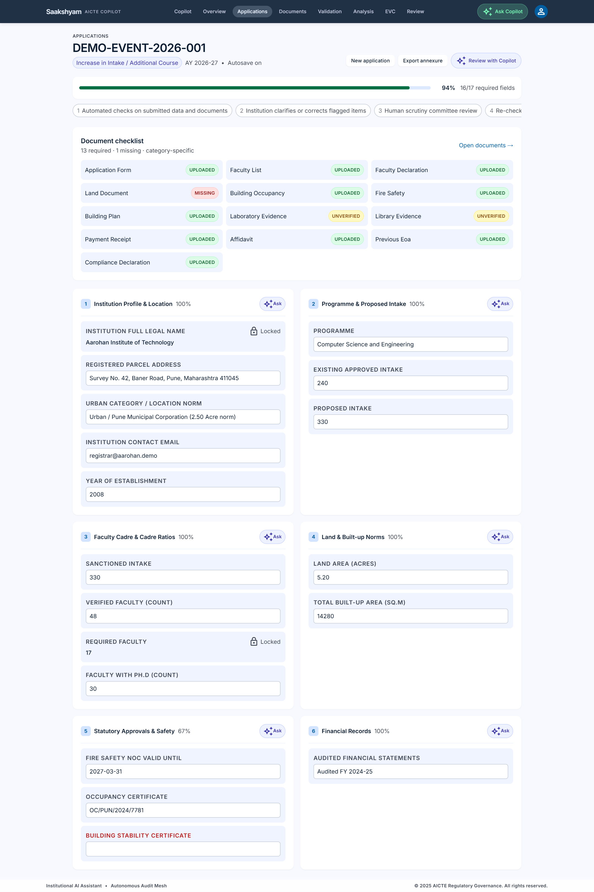<br><sub><b>Application workspace.</b> Category, workflow stages, the 13-item category checklist and all application sections with completion percentages.</sub> | 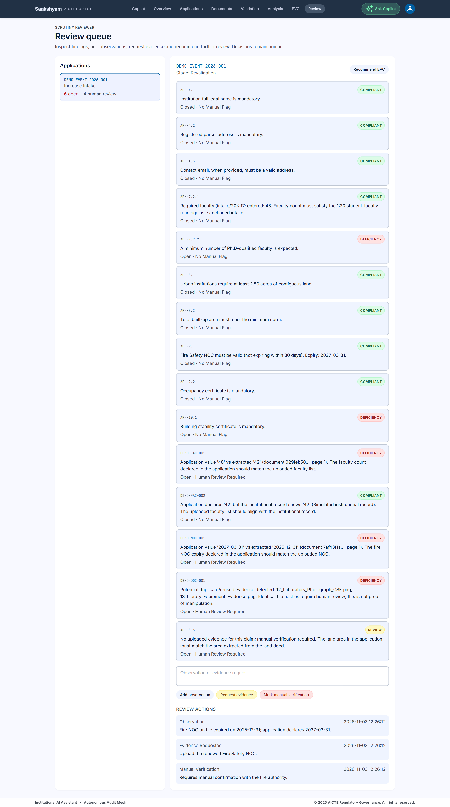<br><sub><b>Reviewer workspace.</b> The scrutiny reviewer sees the queue, selects a finding, and records an observation, an evidence request and a manual-verification flag. Decisions remain human.</sub> |

## 5. Architecture

```
┌─────────────────────────────┐        /api/* rewrite        ┌──────────────────────────────┐
│  Next.js 15 + TypeScript    │ ───────────────────────────▶ │  FastAPI                     │
│  Tailwind (Stitch tokens)   │                              │  SQLAlchemy + SQLite         │
│                             │ ◀─────────────────────────── │                              │
│  /copilot  /  /application  │        SSE + JSON            │  modules: identity,          │
│  /documents /validation     │                              │  applications, documents,    │
│  /analysis /evc /review     │                              │  validation, verification,   │
└─────────────────────────────┘                              │  evc, review, reporting,     │
                                                             │  copilot + LangGraph agent   │
                                                             └──────────────────────────────┘
                                                                       │
                                              PyMuPDF + RapidOCR + rules + SQLite
```

Design principle: the LLM orchestrates and explains; deterministic rules decide
pass/fail; the database is the source of truth; every result is traceable to evidence.

## 6. Repository map

```
apps/api/            FastAPI backend
  app/core/          config, db, security, storage, verification adapter
  app/modules/       identity, applications, documents, validation, verification,
                     evc, review, reporting, copilot, admin, workflows
  app/workers/       document processing (OCR, classification, extraction)
  app/workflows/     category workflow configuration
  tests/             51 pytest tests
apps/web/            Next.js frontend (Copilot + workspaces)
demo-data/           synthetic documents, metadata, dataset
docs/                research, planning, workflows, demo runbook, screenshots
scripts/             generate_demo_data.py, reset_demo.py, e2e_demo.py
prd.md               product requirements
systemdesign.md      system design
```

## 7. Quick start

Requirements: Python 3.11+, Node 24+.

```powershell
# Terminal 1 - backend
cd apps/api
pip install -r requirements.txt
copy ..\..\.env.example .env        # then add your free Groq key (optional)
python -m uvicorn app.main:app --host 127.0.0.1 --port 8000

# Terminal 2 - frontend
cd apps/web
npm install
npm run dev
```

Open **http://localhost:3100/login**.

| Role | Email | Password |
|---|---|---|
| Institution Administrator | `inst.admin@aarohan.demo` | `demo1234` |
| AICTE Scrutiny Reviewer | `scrutiny@aicte.demo` | `demo1234` |
| EVC Reviewer | `evc@aicte.demo` | `demo1234` |
| System Administrator | `sysadmin@aicte.demo` | `demo1234` |

The LLM is optional: without `LLM_API_KEY`, the Copilot uses deterministic responses and
the demo still works end to end.

## 8. Demonstration

The step-by-step judge script is in
[`docs/demo/JUDGE_DEMONSTRATION_RUNBOOK.md`](docs/demo/JUDGE_DEMONSTRATION_RUNBOOK.md).

Short version:

1. Sign in as the institution administrator.
2. Open `DEMO-EVENT-2026-001`; review the category, workflow stages and 13-item checklist.
3. Upload the synthetic documents from `demo-data/documents/`.
4. Run validation; inspect findings and evidence.
5. Verify a document (simulated source) from the Documents inspector.
6. Open **EVC** as a reviewer; analyze infrastructure, recommend a visit, add a note.
7. Upload the corrected faculty summary, add a clarification, revalidate.
8. Open **Validation**; confirm the finding is Resolved and history is retained.
9. Sign in as `scrutiny@aicte.demo`; open **Review** and add observations/evidence requests.
10. Export the report.

Reset the demo:

```powershell
python scripts/reset_demo.py
```

Automated end-to-end check:

```powershell
python scripts/e2e_demo.py      # prints: E2E DEMO: PASS
```

## 9. Tests

```powershell
cd apps/api
python -m pytest -q            # 51 passed
```

Coverage includes: auth/roles, application categories and checklists, document
classification/extraction, cross-document and institutional-record checks, duplicate
detection, all six verification outcomes, EVC workflow, rectification lifecycle,
reviewer actions, report/audit, prompt-injection guard, and the absence of any
approve/reject tool.

## 10. Regulatory grounding and uncertainty

The research record is in
[`docs/research/AICTE_OFFICIAL_PROCESS_RESEARCH.md`](docs/research/AICTE_OFFICIAL_PROCESS_RESEARCH.md).
Primary sources: AICTE's 2026–27 approval-process page, public notice, corrigendum/addendum,
Approval Process Handbook, FAQs and directories.

Important limits:

- The exact 2026–27 processing table and document appendices must be confirmed from the
  official addendum/annexures before production use.
- Public directories are web pages, not documented APIs; the prototype uses simulated
  reference snapshots.
- Verification is **simulated**. The UI always displays:
  `SIMULATED VERIFICATION - NO LIVE GOVERNMENT OR ISSUING-AUTHORITY CONNECTION`.
- Prototype-only rules are labelled "Prototype demo rule".

## 11. Safeguards

- No approve/reject/penalty endpoint exists; final decisions remain human.
- Anomalies are "potential, requiring human review", never proof of forgery.
- Every finding links to the rule, source, values and evidence.
- Role-based access (institution preparer, scrutiny reviewer, EVC reviewer, admin).
- Audit events for uploads, validation, verification, corrections, reviews, EVC and reports.
- Synthetic data only; no real personal or institutional data.

## 12. Limitations and future work

Out of scope for this prototype (documented in `IMPLEMENTATION_PLAN.md`):

- authorised AICTE portal and issuing-authority integrations;
- live QR/digital-signature verification;
- production PostgreSQL/pgvector, object storage, job queue and SSO;
- verified APH annexure document lists and addendum-aware rule corpus;
- legal review of anomaly wording and retention policy.

## 13. Documentation index

- `docs/research/AICTE_OFFICIAL_PROCESS_RESEARCH.md`
- `docs/planning/CURRENT_STATE_AND_GAP_ANALYSIS.md`
- `docs/planning/MVP_IMPLEMENTATION_PLAN.md`
- `docs/workflows/APPLICATION_CATEGORY_WORKFLOWS.md`
- `docs/workflows/VALIDATION_RULES_AND_EVIDENCE_MODEL.md`
- `docs/demo/JUDGE_DEMONSTRATION_RUNBOOK.md`
- `docs/demo/SYNTHETIC_DATA_CATALOG.md`
- `docs/demo/EXPECTED_DEMO_RESULTS.md`

---

Synthetic demonstration project. Not affiliated with AICTE. All institutions, people,
documents and verification responses are fictional.
