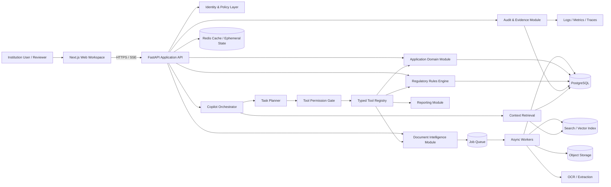

AICTE Copilot --- System Architecture & Design
Document type: System Architecture and Technical Design
Version: 1.0
Status: Proposed baseline for implementation
Product: AICTE Copilot
Primary objective: Build a low-latency, reliable, secure,
evidence-grounded agentic workspace for AICTE application preparation,
document intelligence, preliminary compliance validation, and authorized
scrutiny support.
Architecture principle: The LLM is the interaction and
orchestration layer---not the system of record, rules engine,
permission authority, or source of regulatory truth.

1. Executive Summary
AICTE Copilot is designed as a modular, API-first application with a
conversational agent at its centre. Users interact through natural
language, while the platform coordinates document processing,
application data retrieval, deterministic regulatory checks, evidence
linking, and permitted draft updates.

The architecture prioritizes:
1. Correctness over unconstrained autonomy: deterministic rules
   evaluate structured requirements; the LLM interprets requests, plans
   work, and explains results.
2. Low latency through asynchronous processing: short interactive
   operations remain synchronous; OCR, large document batches, and full
   scrutiny run as background jobs with streaming progress.
3. Evidence provenance: every extracted value and compliance
   finding should be traceable to its source document, page, text
   region, rule version, and validation run.
4. Permission enforcement outside the model: all tools are
   authorized by backend policy before execution.
5. Incremental scalability: begin with a modular monolith and
   independently scalable workers; split services only when measured
   load or team boundaries justify it.
6. Human accountability: no autonomous statutory approval or
   rejection; high-impact actions require explicit authorization and
   official workflows.
The initial deployment should be a modular monolith plus asynchronous
worker pool, not an early microservices architecture. This reduces
operational complexity and network hops while preserving clean module
boundaries for later extraction.
2. Scope and System Boundaries
2.1 In scope
- Institution and user management
- Role-based and institution-scoped authorization
- Application creation and draft management
- Document upload, storage, classification, OCR, and extraction
- Application-aware conversational copilot
- Controlled tool execution and task planning
- Regulatory source and rule version management
- Deterministic validation and cross-document consistency checks
- Evidence-linked findings and revalidation
- Verification adapters for supported QR/signature/issuer checks
- Audit events, reports, and operational telemetry
2.2 Out of scope for the initial release
- Autonomous approval or rejection
- Unapproved access to AICTE or other government systems
- Scraping or bypassing access controls on official portals
- Claims that a document is genuine based only on visual appearance or
  LLM judgement
- Production integrations without documented API availability,
  credentials, and authorization
- Training a foundation model from scratch
2.3 Trust boundaries
Treat the following as untrusted: - User prompts - Uploaded documents
and embedded instructions - OCR output - External API responses -
Retrieved text and vector-search results - Model-generated tool
arguments

Validate and normalize all such inputs before they can affect
application state or invoke privileged operations.
3. Architecture at a Glance

3.1 Request path
1. Browser sends an authenticated request to the API.
2. API validates identity, tenant/institution scope, request schema,
   and rate limits.
3. Application services retrieve the authoritative state from
   PostgreSQL.
4. Copilot orchestrator builds a minimal, permission-filtered context.
5. Model proposes a response or typed tool call.
6. Backend validates tool schema, user permission, application scope,
   and action risk.
7. Tool executes through a domain service.
8. Result is persisted transactionally where applicable.
9. Copilot receives the verified result and explains it.
10. UI receives streamed events and refreshes affected application
    state.
3.2 Document processing path
1. Upload is authorized and stored in quarantine.
2. File type, size, checksum, and malware scan are checked.
3. A processing job is enqueued.
4. Worker performs image/PDF normalization, OCR, classification, and
   structured extraction.
5. Extracted fields are stored with confidence and source coordinates.
6. Evidence references are created.
7. Relevant application fields and validation checks are marked stale.
8. UI receives job status and completion events.
4. Recommended Technology Stack
The following is a pragmatic baseline. Pin exact versions in lockfiles
and update through tested dependency upgrades.
  Layer                   Recommended choice      Rationale
  Web application         Next.js + React +       Strong ecosystem, SSR
TypeScript              where useful, typed UI

  UI styling              Tailwind CSS +          Fast iteration and
accessible component    consistent design
primitives              system

  API/backend             Python FastAPI +        Strong AI/document
Pydantic                ecosystem, typed APIs,
async support

  Primary database        PostgreSQL              Transactions,
relational integrity,
JSONB, mature
operations

  ORM/migrations          SQLAlchemy 2 + Alembic  Explicit data access
and controlled schema
changes

  Cache / ephemeral state Redis                   Rate limits,
short-lived cache, job
coordination, stream
state

  Job queue               Celery or Dramatiq with Retryable background
Redis/RabbitMQ          processing; choose one
and standardize

  Object storage          S3-compatible storage   Durable original files
and generated artifacts

  OCR                     Benchmark PaddleOCR /   Select by language,
managed OCR provider    scan quality,
deployment constraints

  PDF processing          PyMuPDF + OCR fallback  Efficient text
extraction before
expensive OCR

  LLM access              Provider abstraction    Avoid hard coupling to
with structured         one model vendor
output/tool calling     

  Embeddings              Model selected by       Grounded regulatory and
multilingual retrieval  document search
benchmark               

  Vector retrieval        pgvector initially      Keeps early
architecture simple;
upgrade only if
measured need

  Observability           OpenTelemetry +         End-to-end latency and
Prometheus/Grafana +    failure visibility
structured logs         

  Error tracking          Sentry or equivalent    Frontend/backend
exception diagnostics

  Deployment              Docker; managed         Reproducible
container platform      environments and simple
initially               operations
CI/CD                   GitHub Actions or       Automated tests, scans,
equivalent              build, deploy
Do not adopt Kubernetes, Kafka, multiple databases, or a separate
vector database on day one unless the deployment environment or measured
throughput requires them. Complexity is a latency and reliability
cost.
5. Core Architectural Modules
Use domain-oriented modules with explicit interfaces. Initially these
can live in one backend repository and deploy as one API process plus
worker processes.
5.1 Identity and Access Module
Responsibilities: - Authentication and session lifecycle - Institution
membership - Role and permission assignment - Tenant/institution data
scoping - Authorization decisions for tools and APIs

Recommended approach: - OIDC-compatible identity provider where
practical - Short-lived access tokens and refresh-token rotation -
Backend authorization on every request; never trust frontend role
state - Institution ID derived from verified membership, not
user-supplied arbitrary input - PostgreSQL row-level security as defence
in depth where operationally appropriate

Roles are not enough by themselves. Use permissions such as: -
application.read - application.draft.update - document.upload -
document.read - validation.run - report.export -
review.observation.create - application.submit
5.2 Application Domain Module
Owns: - Institution profile - Application and application sections -
Field definitions and values - Draft revisions - Application workflow
state - Completion calculations - Internal tasks and observations

The application database is the source of truth. The LLM must not
store authoritative application state in conversation messages or
memory.

Use optimistic concurrency with a version column or ETag. A write
should include the version it read; reject conflicting updates and ask
the user to refresh/reconcile.
5.3 Document Intelligence Module
Pipeline: 1. Validate upload and checksum. 2. Quarantine and malware
scan. 3. Detect MIME type using file content, not filename alone. 4.
Extract embedded PDF text where usable. 5. Render pages and OCR only
when necessary. 6. Classify document type. 7. Extract typed fields using
schema-constrained extraction. 8. Normalize values (dates, identifiers,
units, names) without discarding originals. 9. Store confidence, page
number, bounding box, extraction method, and model/version. 10. Route
low-confidence or conflicting fields to user review.

Store original document bytes immutably. Derived OCR text and extracted
fields are versioned outputs and can be regenerated.
5.4 Regulatory Knowledge and Rules Module
Separate regulatory source content from executable rules.

Regulatory source record: - Source title and issuing authority -
Official URL or source file - Publication/effective date - Document
checksum - Version and supersession status - Page/section anchors

Rule record: - Rule ID and version - Source reference and page/section -
Applicability predicate - Required input schema - Deterministic
evaluator - Severity and explanation template - Effective dates - Test
cases and approval status

Rules should be reviewed and approved by a designated domain owner
before production activation. Keep previous versions immutable. Each
validation run records the exact rule-set version used.

Use LLM/RAG to explain and retrieve requirements, not to silently invent
or alter executable compliance logic.
5.5 Validation Engine
Implement validation as deterministic, typed functions over normalized
application data and evidence.

Validation categories: - Required-field checks - Conditional
applicability checks - Format/range checks - Cross-field consistency -
Cross-document consistency - Document presence and freshness - Evidence
sufficiency flags - Verification status checks

Every check returns a structured result: - PASS - FAIL -
NEEDS_REVIEW - NOT_APPLICABLE - NOT_EVALUATED

Each finding includes rule ID/version, affected field(s), evidence
references, explanation, severity, and remediation guidance.

Do not collapse NEEDS_REVIEW into FAIL. A missing verification
source is not proof of invalidity.
5.6 Copilot Orchestration Module
The copilot is a bounded state machine around model calls and backend
tools.

Subcomponents: - Intent/context resolver - Application context builder -
Task planner - Typed tool registry - Policy/permission gate - Tool
executor - Result verifier - Response composer - Conversation event
publisher

Use a bounded plan-execute-observe loop: 1. Model interprets request
and proposes next action. 2. Orchestrator validates the proposed action.
3. Tool runs with scoped arguments. 4. Tool result is checked against
schema and expected postconditions. 5. Orchestrator updates task state.
6. Model receives compact result and continues or responds.

Set hard limits: - Maximum tool calls per user turn - Maximum plan
depth - Per-tool timeout - Overall task deadline - Maximum retries -
Token/context budget - Allowed tool list per role and application state

Never allow arbitrary Python, shell, SQL, URL fetch, or unrestricted
database tools to be exposed to the model.
5.7 Evidence and Audit Module
Evidence references should identify: - Document ID and immutable
version - Page number - Text span or bounding box where available -
Extracted field ID - Extraction run ID - Hash/checksum - Timestamp

Audit events should be append-only at the application level and
include: - Actor and role - Institution/application scope - Action and
target - Before/after values for relevant changes - Tool execution ID -
Confirmation metadata - Timestamp and correlation ID

Avoid storing secrets, full access tokens, or unnecessary sensitive
document contents in logs.
5.8 Reporting Module
Generate reports from persisted application, validation, and evidence
data---not from a free-form LLM summary alone.

LLM can draft narrative explanations, but totals, statuses, rule IDs,
and evidence lists must be sourced from structured records.
6. Agent and Tool Design
6.1 Typed Tool Contract
Each tool must declare: - Stable tool name and version - Description and
intended use - JSON input schema - JSON output schema - Required
permission - Read/write classification - Risk tier - Timeout and retry
policy - Idempotency behavior - Audit requirements

Example tool inventory:
  Tool                             Operation         Permission                 Risk
  get_application_summary        Read current      application.read           Read
application
status                                       

  get_application_section        Read a section    application.read           Read

  list_documents                 List scoped       document.read              Read
documents                                    

  extract_document_fields        Retrieve          document.read              Read
extraction
results                                      

  run_validation                 Execute selected  validation.run             Controlled
rules                                        

  compare_application_evidence   Compare values    application.read           Read
and evidence                                 

  propose_field_updates          Prepare draft     application.draft.update   Draft
changes                                      

  apply_draft_updates            Persist approved  application.draft.update   Write
draft changes                                

  create_review_task             Create internal   task.create                Write
task                                         
generate_compliance_report     Generate report   report.export              Controlled
6.2 Tool Execution Safety
For every tool call: 1. Validate JSON schema. 2. Resolve user identity
and institution membership from authenticated context. 3. Verify
permission and application ownership. 4. Check current application state
and workflow restrictions. 5. Apply idempotency key for write
operations. 6. Execute through domain service. 7. Persist audit event.
8. Return a typed result.

The model cannot provide its own permission claims or override
server-side policy.
6.3 Confirmation Model
- Read-only actions: execute if authorized.
- Low-risk reversible draft changes: show preview and apply according
  to explicit user confirmation policy.
- High-impact or irreversible actions: require explicit confirmation
  and, where relevant, stronger authentication or a second authorized
  reviewer.
- Official submission/approval: remain within the authorized official
  process.
6.4 Prompt Injection Defence
- Treat document text and retrieved content as data, never as
  instructions.
- Delimit and label untrusted content in model context.
- Do not let retrieved documents alter tool permissions or system
  policy.
- Use allowlisted tools and strict schemas.
- Validate every tool argument server-side.
- Require confirmation for sensitive writes.
- Test malicious instructions embedded in PDFs and OCR text.
7. Data Architecture
7.1 PostgreSQL as System of Record
Recommended core tables: - users - institutions -
institution_memberships - roles - permissions - applications -
application_sections - application_fields -
application_field_values - documents - document_versions -
document_processing_runs - extracted_fields -
evidence_references - regulatory_sources - regulatory_rules -
regulatory_rule_versions - validation_runs - validation_findings -
verification_records - conversations - conversation_messages -
agent_tasks - tool_executions - audit_events - outbox_events

Use UUID primary keys, foreign keys, explicit unique constraints,
timestamps, and soft deletion only where legally and operationally
appropriate.
7.2 Multi-Tenancy
For the initial institution-scoped product: - Include institution_id
on institution-owned records. - Enforce institution scope in
service/repository methods. - Add PostgreSQL row-level security as
defence in depth if compatible with connection pooling and operational
model. - Test cross-tenant access attempts explicitly. - Never accept
institution scope from the model as authoritative.
7.3 JSONB Use
Use relational columns for important searchable and constrained fields.
Use JSONB for flexible extracted payloads and versioned rule
configuration where schema evolution requires it. Validate JSONB
payloads at application boundaries.
7.4 Vector Search
Start with PostgreSQL + pgvector for: - Regulatory paragraph retrieval -
Document semantic search - Similarity-assisted entity/document matching

Use hybrid retrieval: - Metadata filters first (institution,
application, document permissions, rule version) - Lexical search for
exact identifiers and terms - Vector search for semantic similarity -
Reranking for relevance where evaluation justifies it

Never rely on vector similarity alone for compliance decisions or exact
field matching.
8. API and Event Design
8.1 API conventions
- REST APIs under /api/v1
- OpenAPI schema generated from FastAPI
- Pydantic request/response models
- Consistent error envelope
- Cursor pagination for large collections
- Idempotency keys for write operations
- Request IDs and correlation IDs
- Explicit API versioning for breaking changes
Example endpoints:
POST   /api/v1/applications
GET    /api/v1/applications/{application_id}
PATCH  /api/v1/applications/{application_id}/sections/{section_id}
POST   /api/v1/documents/upload-intents
POST   /api/v1/documents/{document_id}/process
GET    /api/v1/documents/{document_id}/status
POST   /api/v1/applications/{application_id}/validations
GET    /api/v1/validations/{validation_run_id}
GET    /api/v1/validations/{validation_run_id}/findings
POST   /api/v1/copilot/conversations
POST   /api/v1/copilot/conversations/{conversation_id}/messages
GET    /api/v1/copilot/tasks/{task_id}
GET    /api/v1/applications/{application_id}/events
8.2 Streaming
Use Server-Sent Events (SSE) for one-way assistant/task progress
updates; use WebSockets only if true bidirectional realtime interaction
is required.

Suggested event types: - message.delta - task.started -
task.plan - tool.started - tool.completed - tool.failed -
document.processing - validation.progress - application.updated -
finding.created - task.completed

Events should contain IDs and status summaries, not large document
payloads. The client fetches authoritative state through APIs.
8.3 Transactional Outbox
When a database transaction must trigger a background job or event: -
Persist the domain change and outbox event in the same transaction. - A
dispatcher publishes the event. - Consumers are idempotent. - Mark
delivery state and retry safely.

This prevents lost jobs between database commit and queue publication.
9. Performance and Low-Latency Strategy
Performance targets below are initial engineering SLOs to validate
under representative load, not guaranteed current performance.
9.1 Suggested SLOs
  Operation                                                Initial target
  Cached read API p95                                            <200 ms

  Typical uncached read API p95                                  <400 ms

  Draft update API p95                                           <500 ms
(excluding model time)         

  First visible copilot response                                  <2.5 s
token p95                      

  Simple read-only copilot task                                     <5 s
p95                            

  Document processing             Async; report queue and completion time
separately

  Validation of a normal-sized      Target <5 s for deterministic rules,
application                                         benchmark-dependent
API availability                99.5% initial target, excluding planned
maintenance
Measure p50, p95, and p99. Do not optimize only average latency.
9.2 Reduce Model Latency
- Use a small/fast model for intent classification, routing, and
  simple extraction where benchmarked.
- Use a stronger model only for complex reasoning and ambiguous
  explanations.
- Avoid multiple sequential LLM calls when one structured call is
  sufficient.
- Parallelize independent read-only retrieval and document lookups.
- Keep tool outputs compact and schema-based.
- Use streaming for user-visible responses.
- Set token budgets and stop conditions.
- Cache stable regulatory retrieval results by rule version and query
  fingerprint.
- Do not cache user-specific sensitive results across authorization
  boundaries.
Use model routing based on task complexity and measured quality, not
model size assumptions.
9.3 Reduce Database Latency
- Add indexes for actual query patterns: institution_id,
  application_id, status, created time, and foreign keys.
- Use connection pooling with bounded pool sizes.
- Avoid N+1 queries; use eager loading or batched queries.
- Paginate large document/finding lists.
- Use read-through caching only for safe, frequently accessed
  summaries.
- Invalidate cache on writes using version keys or domain events.
- Inspect query plans before adding indexes indiscriminately.
9.4 Document Processing Efficiency
- Extract embedded PDF text before OCR.
- OCR only pages that need it.
- Detect blank/duplicate pages and repeated files.
- Batch pages within memory limits.
- Run CPU-heavy OCR in worker processes, not the API event loop.
- Use separate worker queues for CPU-heavy OCR and lightweight tasks.
- Apply per-file and per-page limits.
- Store intermediate artifacts only when useful for reproducibility or
  debugging.
- Reprocess only changed documents or failed stages.
9.5 Incremental Validation
Maintain dependency relationships between: - Application fields -
Extracted fields - Regulatory rules - Validation findings

When a field changes, mark only dependent checks stale and rerun those
checks. Full scrutiny remains available on demand and before important
workflow milestones.
9.6 Concurrency and Backpressure
- Bound worker concurrency based on CPU, memory, and provider quotas.
- Set queue limits and per-institution quotas.
- Apply rate limits to chat, upload, and expensive processing
  operations.
- Return a clear queued state rather than letting requests time out.
- Use exponential backoff with jitter for transient external failures.
- Use circuit breakers for unreliable external verification providers.
- Avoid retrying non-idempotent operations without an idempotency key.
10. Accuracy and Evaluation Strategy
Accuracy must be measured by task. A single "AI accuracy" number is
misleading.
10.1 Document Extraction
Build a labelled evaluation set covering: - Native PDFs - Scanned PDFs -
Low-resolution scans - Rotated pages - Tables - Multi-page records -
Different document templates - Relevant Indian languages if required

Metrics: - Exact-match accuracy by field - Character/word error rate for
OCR - Precision/recall/F1 for extracted entities - Date and numeric
normalization accuracy - Confidence calibration - Rate of fields
correctly abstained for human review

Keep training/tuning and test sets separate. Split by
document/institution/template where possible to avoid leakage.
10.2 Discrepancy Detection
Create test cases with known: - Matching records - Name variations -
Date mismatches - Count mismatches - Missing evidence - Duplicate
records - Ambiguous cases

Measure precision, recall, F1, false-positive rate, and false-negative
rate by discrepancy type. For high-impact findings, prioritize precision
and clear abstention behavior.
10.3 Regulatory Retrieval and Explanation
Evaluate: - Recall@k for relevant source passages - Citation
correctness - Rule-version correctness - Answer faithfulness to
retrieved source - Unsupported-claim rate - Correct abstention when
source evidence is insufficient

Every answer about a specific requirement should identify its source and
effective/version context when available.
10.4 Agent Task Evaluation
Maintain a fixed scenario suite for: - Read-only questions - Multi-step
document tasks - Draft updates - Validation runs -
Correction/revalidation - Permission denial - Malicious document prompt
injection - Tool timeout and partial failure

Measure: - End-to-end task success - Tool selection accuracy - Invalid
tool-call rate - Unauthorized action rate (must be zero in tests) -
Recovery rate after transient failure - User correction/undo rate
10.5 Release Gates
Do not ship a model, prompt, OCR, or rule change solely because it
appears better in a few demos. Require: - Regression test suite -
Representative holdout evaluation - Security and permission tests -
Latency/cost benchmark - Human review of high-impact changes - Rollback
path
11. Reliability and Failure Handling
Every long-running task has an explicit state: - QUEUED - RUNNING -
SUCCEEDED - PARTIALLY_SUCCEEDED - FAILED - CANCELLED

Design for partial failure. Example: OCR may succeed for 8 of 10
documents. Preserve successful outputs, report failed files, and allow
retry without repeating completed work.

Requirements: - Timeouts on every external call - Retries only for
transient, retryable errors - Exponential backoff with jitter -
Idempotent job handlers - Dead-letter queue or failed-job store -
User-visible task status - Cancellation where safe - Graceful
degradation when LLM or verification providers are unavailable

If the LLM is unavailable, users should still be able to access
documents, application data, and deterministic validation through
standard UI/API workflows.
12. Security and Privacy Standards
Use current, organization-approved versions of the following as design
references; verify applicability with the deployment authority and
legal/security team.
- OWASP ASVS: application security verification baseline.
- OWASP Top 10: common web application risks.
- OWASP API Security Top 10: API authorization and abuse risks.
- OWASP Top 10 for LLM Applications: prompt injection, insecure
  output handling, excessive agency, sensitive information disclosure,
  and related AI risks.
- NIST AI Risk Management Framework: AI risk governance and
  lifecycle controls.
- NIST SSDF: secure software development practices.
- WCAG 2.2 AA: accessibility target for the web interface.
- OpenTelemetry semantic conventions: consistent observability
  instrumentation.
Implementation controls: - TLS for all network traffic. - Encryption at
rest for database, object storage, and backups. - Managed secrets; no
credentials in source code. - Least-privilege service identities. -
Secure HTTP headers and CSRF protections where applicable. - Strict CORS
allowlist. - Upload validation and malware scanning. - Content Security
Policy. - Dependency and container image scanning. - Backup encryption
and restore testing. - Data retention and deletion policy. - Audit
access to sensitive records. - No sensitive document content in general
application logs. - Redaction of PII in traces and error reports.

Do not claim legal or regulatory certification merely because the design
references these standards.
13. Observability and Operations
Instrument every request and background task with: - request_id -
trace_id - institution_id (pseudonymized in telemetry where
appropriate) - application_id (avoid exposing identifiers
unnecessarily) - conversation_id - agent_task_id -
tool_execution_id - document_processing_run_id

Track: - API latency and error rates - LLM time-to-first-token and total
latency - Tokens and cost per task - Tool call count and failure rate -
Queue depth and queue wait time - OCR pages per minute - OCR/extraction
failure rate - Validation runtime - Database pool saturation - Cache hit
ratio - External provider latency and availability

Use distributed traces to identify whether latency is caused by model
inference, database access, OCR, queue delay, or external verification.

Define alerts for elevated errors, queue backlogs, provider failures,
storage capacity, and unusual authorization denials.
14. Deployment Architecture
14.1 Initial environments
Maintain separate: - Local development - Automated test - Staging -
Production

Use environment-specific secrets, databases, object storage buckets, and
provider credentials.
14.2 Initial production topology
- Next.js frontend behind CDN/reverse proxy
- FastAPI API instances
- Dedicated worker process group
- PostgreSQL managed database
- Redis managed instance
- S3-compatible object storage
- LLM/OCR provider adapters
- Centralized logs, metrics, traces, and error reporting
Scale API instances horizontally. Scale OCR and extraction workers
independently based on queue depth and resource consumption.
14.3 CI/CD pipeline
1. Format and lint.
2. Type checks.
3. Unit tests.
4. API contract tests.
5. Integration tests.
6. Database migration validation.
7. Dependency and secret scanning.
8. Container build and scan.
9. Deploy to staging.
10. Smoke and end-to-end tests.
11. Controlled production rollout.
12. Monitor and rollback if SLOs or error budgets are breached.
Use backward-compatible database migrations (expand/contract) to avoid
downtime during rolling deployments.
15. Repository Structure
A practical monorepo layout:
aict e-copilot/
  apps/
    web/
      src/
        app/
        components/
        features/
        lib/
        styles/
    api/
      app/
        api/
        core/
        modules/
          identity/
          institutions/
          applications/
          documents/
          copilot/
          regulations/
          validation/
          verification/
          reporting/
          audit/
        workers/
        integrations/
        tests/
  packages/
    contracts/
    ui/
    shared-types/
  infra/
    docker/
    deployment/
    monitoring/
  docs/
    architecture/
    api/
    decisions/
    threat-model/
  scripts/
  .github/workflows/
Keep module dependencies explicit. Domain modules should not import each
other's internal persistence models directly; communicate through
service interfaces or domain contracts.
16. Key Architecture Decisions (ADRs)
ADR-001: Modular monolith before microservices
Decision: Start with one backend codebase and separate API/worker
processes.

Reason: Lower operational overhead, fewer network hops, easier
transactions, faster development. Extract services only when scaling,
reliability, or team ownership requires it.
ADR-002: PostgreSQL as source of truth
Decision: Store authoritative application, rule, validation, and
audit metadata in PostgreSQL.

Reason: Strong consistency, relational integrity, transactions, and
mature operational tooling.
ADR-003: LLM does not execute SQL or own business logic
Decision: All actions go through typed, permission-checked domain
tools.

Reason: Prevents arbitrary access, improves testability, and makes
actions auditable.
ADR-004: Deterministic rules for compliance outcomes
Decision: Use versioned executable rules for explicit requirements;
use LLMs for interpretation assistance and explanation.

Reason: Reproducibility, traceability, and reduced hallucination
risk.
ADR-005: Asynchronous document processing
Decision: Upload and processing are separate operations connected by
jobs/events.

Reason: OCR and parsing are resource-intensive and should not block
interactive API requests.
ADR-006: pgvector before a dedicated vector database
Decision: Start with PostgreSQL and pgvector.

Reason: Fewer systems to operate; supports early hybrid retrieval.
Reassess with measured scale and retrieval performance.
ADR-007: SSE for assistant progress
Decision: Use SSE for server-to-client streaming unless
bidirectional realtime requirements emerge.

Reason: Simpler than WebSockets for token and task-status streaming.
ADR-008: Evidence-first findings
Decision: Persist evidence references and rule references as part of
each finding.

Reason: Explainability, reviewer trust, and auditability.
ADR-009: Human control for high-impact actions
Decision: No autonomous statutory approval/rejection; high-impact
operations require explicit authorization.

Reason: Preserves legal accountability and prevents excessive agent
autonomy.
17. Implementation Roadmap
Stage 1 --- Foundations
- Repository and CI/CD
- Authentication and institution isolation
- PostgreSQL schema and migrations
- Application domain model
- Stitch-matched frontend shell
- Audit/event foundations
Stage 2 --- Document intelligence
- Secure upload
- Object storage
- PDF text extraction
- OCR worker pipeline
- Structured extraction
- Evidence references
- Document preview and review
Stage 3 --- Copilot foundation
- Conversation API and streaming
- Application context builder
- Typed tool registry
- Permission gate
- Read-only tools
- Tool execution tracing
- Agent evaluation scenarios
Stage 4 --- Compliance intelligence
- Regulatory source ingestion
- Rule schema and versioning
- Deterministic rules engine
- Validation runs and findings
- Cross-field and cross-document checks
- Evidence-linked explanations
Stage 5 --- Closed-loop agent
- Draft update proposals
- Confirmation workflow
- Persisted draft updates
- Incremental revalidation
- Reports and exports
- Full end-to-end demo
Stage 6 --- Hardening
- Load and soak tests
- Security testing
- Prompt-injection evaluation
- OCR and retrieval benchmarks
- Backup/restore exercises
- Accessibility review
- Production readiness review
18. Engineering Principles
1. Backend state is authoritative. Never infer persisted state from
   chat text.
2. Evidence before assertion. Important findings need source
   references.
3. Rules before model judgement. Deterministic requirements must be
   evaluated deterministically.
4. Abstain when uncertain. Use NEEDS_REVIEW rather than fabricate
   certainty.
5. Least privilege everywhere. The model receives only the tools
   and context required for the task.
6. Async for expensive work. Do not hold HTTP requests open for OCR
   or large scrutiny jobs.
7. Incremental computation. Reprocess only changed inputs and
   dependent checks.
8. Measure before scaling. Avoid premature microservices and
   infrastructure complexity.
9. Every write is auditable. Include actor, scope, reason, and
   before/after state.
10. Design for graceful degradation. Core application and validation
    workflows should remain accessible when an AI provider is
    unavailable.
19. Open Decisions to Resolve Before Production
These require product, regulatory, security, and deployment input:
- Exact AICTE application types and approval cycles in scope
- Official source corpus and process for approving rule
  interpretations
- Hosting jurisdiction and institutional data residency requirements
- Identity provider and institutional SSO requirements
- OCR language coverage and representative document dataset
- LLM provider, deployment model, and data-processing terms
- Availability of authorized QR, digital-signature, or issuer
  verification endpoints
- Retention, archival, and deletion requirements
- Expected concurrent users, documents per application, and peak
  submission load
- Whether official reviewers are in scope for the same deployment
- Human approval process for regulatory rule updates
Do not build assumptions about official API access into core product
logic. Use provider adapters and manual fallback until access is
confirmed.
20. Definition of Architecture Success
The architecture is successful when the system can reliably demonstrate
this complete workflow:
1. An authorized user creates an application.
2. The user uploads supporting documents securely.
3. The platform extracts structured information with page-level
   provenance.
4. The user asks the copilot to populate application fields.
5. The copilot retrieves context and proposes changes through typed
   tools.
6. The backend checks permissions and obtains required confirmation.
7. The application draft is updated transactionally.
8. The rules engine runs applicable checks.
9. Findings link to regulatory rules and supporting evidence.
10. The user corrects a finding and affected checks are rerun.
11. The system generates an auditable report.
12. No model-generated action bypasses authorization or official
    decision-making.
Final design position: Build a fast, modular, evidence-grounded
regulatory workflow platform with an agentic conversational
interface---not a chatbot with access to a database. This is the
foundation for accuracy, performance, trust, and long-term
extensibility.